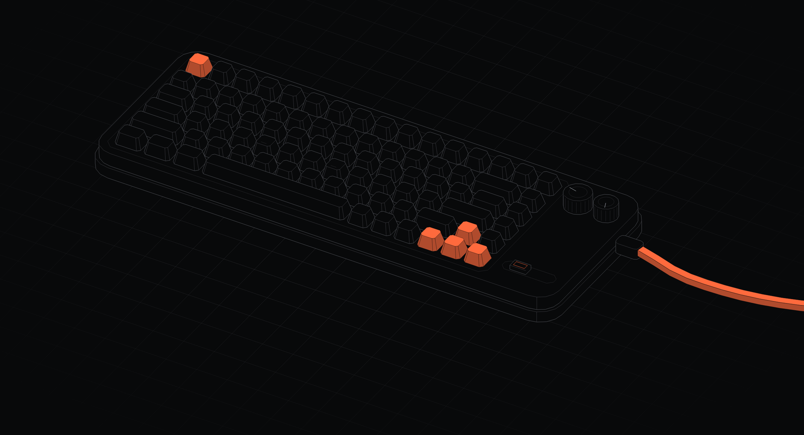
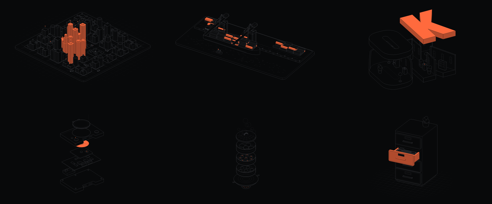

# Isoline

Tiny isometric worlds drawn in hairlines. They move on their own and answer the pointer.



**[Play with it on picker.studio](https://picker.studio/tools/isoline)**: pick a scene, a palette, a camera, then export an SVG, a PNG, a video or an embed snippet without writing a line of code.

This repo is the engine behind it: one vanilla JavaScript file, no dependency, 47 KB gzipped. Use it as is, tune every option, or draw your own scenes with its pen.



## Fourteen scenes

| Scene | What happens |
|---|---|
| `city` | Towers and real traffic. Towers near the pointer rise. |
| `supply` | Factory, warehouse, store, trucks on a loop. Hover to slow the clock. |
| `flight` | An airliner between two airports. Clouds make way for the pointer. |
| `delivery` | A drone delivering parcels. Click a house to send it. |
| `port` | Cranes unloading a container ship. Hover a container to read its number. |
| `line` | A production line with robots. Hover a station to name it. |
| `product` | An exploded view: `phone`, `speaker`, `floppy` or `ps1` (option `product`). |
| `steamer` | A dim sum steamer, its baskets lifting. |
| `cabinet` | A filing cabinet. Point at a drawer, then at a folder. |
| `lockers` | A bank of lockers. Point at a door to swing it open. |
| `keyboard` | A mechanical keyboard that types by itself. Keys dip under the pointer. |
| `interface` | An app window in layers. The pointer takes over the cursor. |
| `relief` | Your word or logo as a field of pillars (option `grid`). |
| `word` | Your word or logo cut open like a dollhouse, rooms furnished (option `shape`). |

## Quick start

```html
<div id="isoline" style="width:100%;aspect-ratio:16/10"></div>

<script src="https://cdn.jsdelivr.net/gh/JuPicker/isoline@1.0.0/isoline.min.js"></script>
<script>
  new Isoline(document.getElementById("isoline"), {
    scene: "keyboard",
    accent: "#ff6a3d",
    floor: "grid",
  });
</script>
```

Or download `isoline.min.js` and host it yourself. Isoline fills its container and keeps the scene centred, so give the container a size.

With a bundler (Vite, Next.js, webpack), copy `isoline.js` and `isoline.d.ts` into your project and import it. The engine touches the page only when you create an instance, so it is safe to import on the server; create the instance in the browser. A React component is in [`examples/react`](examples/react/IsolineScene.tsx).

## Options

Everything is optional. Change any of them later with `instance.set({ ... })`.

| Option | Default | |
|---|---|---|
| `scene` | `"city"` | One of the fourteen scenes above, or one of yours. |
| `product` | `"phone"` | `product` scene: `phone`, `speaker`, `floppy`, `ps1`. |
| `seed` | `7` | Layout of the scenes drawn at random. |
| `density` | `0.5` | 0 to 1, read by each scene its own way: traffic, yard stacks, typing speed, one or two floors in `word`... |
| `explode` | `0.5` | 0 to 1: how far `product`, `steamer`, `interface` and `word` open. |
| `speed` | `1` | Animation speed. |
| `azimuth` | `45` | Camera turn, -90 to 90 degrees. |
| `elevation` | `30` | Camera tilt, 12 to 70 degrees. |
| `spin` | `false` | Turntable: the camera circles the scene. |
| `parallax` | `true` | The camera leans a little towards the pointer. |
| `interactive` | `true` | The scene answers the pointer. |
| `labels` | `true` | Labels and callouts. |
| `names` | `[]` | Your own label texts, in the order `Isoline.labels(scene, product)` lists them. |
| `stroke` | `0.9` | Line width in px. |
| `plate` | `"#08090a"` | Ground colour, the background. |
| `hi` | `"#d0d6e0"` | Lit lines. |
| `edge` | `"#5b5d64"` | Silhouettes. |
| `mid` | `"#3e3e44"` | Creases. |
| `lo` | `"#29292d"` | Back lines and small details. |
| `accent` | `"#d0d6e0"` | What moves or answers the pointer. |
| `solidAccent` | `true` | Accents as solid fills (full top, shaded sides). `false` draws them as lines. |
| `floor` | `"none"` | A floor that fades out towards the edges: `none`, `grid` or `dots`. |
| `floorSpacing` | `0.5` | 0 dense to 1 wide. |
| `floorReach` | `0.5` | How far the floor runs before it fades. |
| `floorStrength` | `0.6` | 0 faint to 1 strong. |
| `floorColor` | `""` | Floor colour. Empty uses `mid`. |
| `grid` | `[...]` | `relief`: one string per row, one digit per cell, 0 empty to 9 tallest. |
| `shape` | `[]` | `word`: letter outlines as rings of `[x, y]` points (y down), holes included. Empty draws "OK". Any scale works. |
| `respectReducedMotion` | `true` | With reduced motion asked by the visitor, the scene holds a readable pose and only redraws on input. |

Palettes that work: keep `plate`, `lo`, `mid`, `edge` and `hi` as five steps of one hue, from the background to the brightest line, and give `accent` its own colour.

```js
// Blueprint
{ plate: "#0b2a5b", lo: "#25467c", mid: "#4a6fa8", edge: "#8fb0e6", hi: "#f2f6ff", accent: "#ffd166" }
// Paper
{ plate: "#ffffff", lo: "#e0e0e4", mid: "#c3c3c9", edge: "#a4a4ac", hi: "#232327", accent: "#2f5bff" }
```

## API

```js
const iso = new Isoline(element, options);

iso.set({ scene: "port", azimuth: -30 }); // change anything, any time
iso.pause();
iso.play();
const svg = iso.toSVG(1600, { transparent: true }); // the current frame, colours inlined: pastes into Figma as vectors
iso.destroy();

Isoline.DEFAULTS;                  // every option and its default
Isoline.SCENES;                    // every scene name, yours included
Isoline.labels("supply");          // ["Factory", "Warehouse", "Store"], the order `names` follows
```

Pass `onFps: (fps) => {}` in the options to read the frame rate. Isoline pauses itself when it scrolls out of view.

## Make your own scene

A scene is two functions. `init` builds its state once. `frame` describes one frame to the pen, which projects it and paints it back to front. A full example is in [`examples/custom-scene.html`](examples/custom-scene.html).

```js
Isoline.defineScene("racks", {
  describe: "a row of server racks",      // for the aria-label
  labels: ["Rack"],                        // the texts `names` can override

  init(o, random) {
    const racks = [0, 11, 22, 33].map((x) => ({ x, y: 0 }));
    return { b: [-6, -6, 39, 6, 24], racks };   // b: the scene's extent [x0, y0, x1, y1, top]
  },

  frame(x) {
    const P = x.pen, k = Isoline.kit;
    k.plinth(P, x.st.b);
    x.st.racks.forEach((r) => {
      const hovered = x.ptr.on && k.ptrDist(x, r.x, r.y, 22) < 5;
      P.begin(P.key(r.x, r.y, 0));                       // one group per object
      P.box(r.x, r.y, 0, 8, 8, 22, { r: 0.4, cls: hovered ? "acc" : "" });
      P.end();
    });
  },
});

new Isoline(el, { scene: "racks" });
```

World units: x and y lie on the ground, z goes up. The view scales itself to fit the scene's extent.

### What `frame(x)` gets

| | |
|---|---|
| `x.pen` | The pen (below). |
| `x.st` | Your state, as `init` returned it. |
| `x.dt` | Seconds since the last frame, scaled by `speed`. |
| `x.ptr` | The pointer: `on`, `sx`/`sy` on screen, `x`/`y` where it meets the ground, `nx`/`ny` from -1 to 1. |
| `x.o` | The options. |
| `x.ease(key, target, rate)` | A value that eases towards `target`, remembered under `key` between frames. |
| `x.click` | The last click: `[x, y]` on the ground, then `[screenX, screenY]`; `null` most frames. |
| `x.reduced` | The visitor asked for reduced motion. |

### The pen

| | |
|---|---|
| `box(cx, cy, z, w, d, h, { r, rot, cls })` | A rounded box standing on z. |
| `cyl(cx, cy, z, r, h, { cls })` | A cylinder. |
| `solid(rings, { cls, crease })` | Any convex solid, from rings of `[x, y, z]` points. |
| `flat(points, { cls })` / `rect(cx, cy, z, w, d)` | A filled polygon lying in space. |
| `line(points, { cls })` | A polyline. |
| `dot(x, y, z, r, { ring, cls })` | A disc lying flat. |
| `sphere(x, y, z, r)` / `light(x, y, z, r, { cls })` | A sphere outline, a small filled light. |
| `text(x, y, z, str)` / `callout(x, y, z, str, { h, cls })` | A label, a label on a pin. |
| `begin(key)` ... `end()` | A group: its parts paint in the order drawn; groups sort by key. |
| `key(x, y, z)` | Paint key of a point, larger is nearer the eye. Key an object standing on the ground at its base. |

`cls` tints a shape: `""` as drawn, `"hi"` lit, `"lo"` faint, `"acc"` accent. Outside a group, lines, dots and lights sit on the top layer, over every solid; pass `layer: 1` to sort them with the solids. Inside a group, every part follows the group.

**Painting order, the one rule:** draw each object in its own group keyed at its base, and draw what rests on an object inside that object's group. Long objects next to small ones can need to be cut in pieces, each keyed on its own.

### `Isoline.kit`

The engine's own pieces, so you do not start from zero.

- Maths: `project`, `unproject`, `key`, `falloff`, `smoothstep`, `clamp`, `lerp`, `rad`, `dist`, `random(seed)`.
- Pointer at a height: `ptrAt(x, z)` (where its line of sight crosses z), `ptrDist(x, cx, cy, h)` (how far it passes from something standing h high; 0 on its top or its side). Test hovers with these, not with the ground point, or the hover lands behind tall things.
- Rings for `pen.solid`: `rect`, `box`, `octagon`, `ring` (circle or ellipse across an axis), `extrudeX`, `extrudeY`, `extrudeZ`, `beam`, `bar`, `cone`, `dome`, `cylinder`, and `frame(cx, cy, cz, yaw, pitch, roll, scale)` with `Model` to draw a model in its own local frame.
- Ready-made: `car(P, x, y, yaw, kind, cls)` (`sedan`, `hatch`, `suv`, `van`, `bus`, `taxi`), `plane`, `drone`, `house(P, x, y, yaw, { s, roof })`, `tree(P, x, y, s, pine)`, `crate(P, x, y, z, s, yaw, cls)`, `container(P, cx, cy, z, cls)`, `furniture(P, kind, x, y, z, yaw, s, lit)` (`desk`, `sofa`, `shelf`, `arcade`, `drawers`, `speaker`, `plant`, `lamp`), `plinth(P, b)`, `corners(b, z)`.

## Examples

- [`examples/basic.html`](examples/basic.html): one scene, a few options.
- [`examples/all-scenes.html`](examples/all-scenes.html): every scene and palette, switchable.
- [`examples/custom-scene.html`](examples/custom-scene.html): a scene of your own with `defineScene` and `kit`.
- [`examples/react/IsolineScene.tsx`](examples/react/IsolineScene.tsx): a React component.

The HTML examples open straight from the folder, no build step.

## Credits

Made by [Julien Picker](https://picker.studio), designer and maker. Need scenes made for your own product? [Get in touch](https://picker.studio).

The line language and the isometric maths are adapted from [hairline](https://github.com/lucasmarkes/hairline) by Lucas Marques (MIT): orthographic camera, solids drawn as one silhouette and their creases, plates filled with the ground colour and painted back to front, the stepped falloff.

MIT licensed. See [LICENSE](LICENSE).
